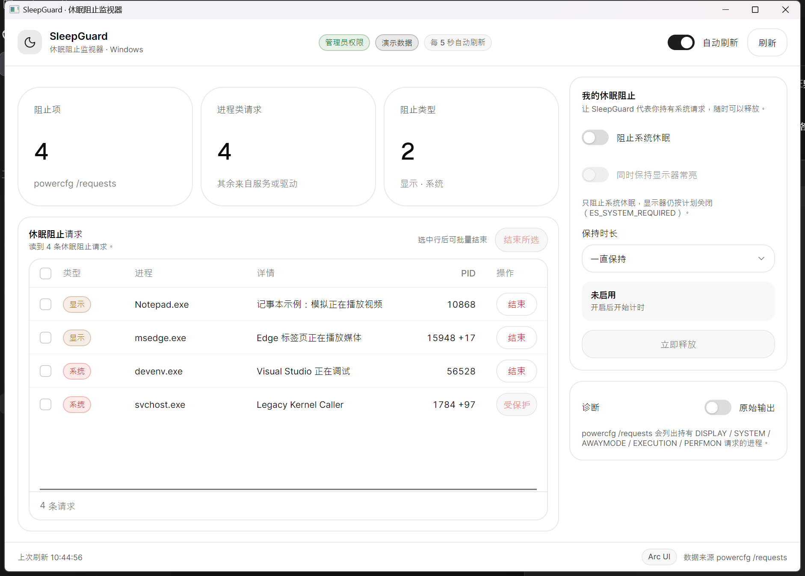
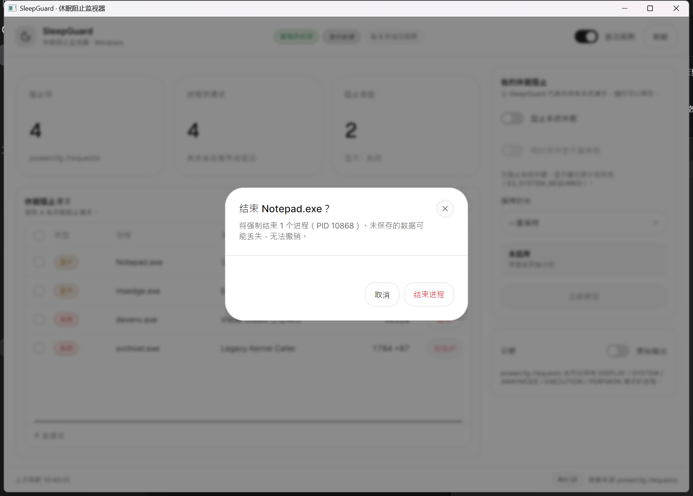

# SleepGuard · 休眠阻止监视器

[](https://github.com/dameng324/SleepGuard/actions/workflows/release.yml)
[](https://github.com/dameng324/SleepGuard/releases)
[](LICENSE)

一个用 **Avalonia + [TKCode.Arc](https://github.com/AIDotNet/TKCode.Arc)** 写的 Windows 桌面小工具，用来：

- **查看**当前系统里有哪些程序正在阻止系统休眠（显示器关闭、系统休眠、离开模式……）；
- **手动结束**这些程序（单个或批量），终结“合盖不休眠、屏幕不关”的元凶；
- **手动开启**“阻止系统休眠”，并可选同时保持显示器常亮、设定自动释放时长。



## 功能一览

| 能力 | 说明 |
|---|---|
| 阻止项列表 | 解析 `powercfg /requests`，按类型（显示 / 系统 / 离开模式 / 执行 / 性能监视）展示请求方进程、PID 与原因 |
| 结束进程 | 每行一个“结束”按钮；整行可勾选后“结束所选”；执行前有确认弹窗，并列出将被结束的 PID |
| 安全保护 | 系统关键进程（`svchost.exe`、`winlogon.exe` 等）、本程序自身、PID ≤ 4 一律标记为“受保护”，不可结束 |
| 主动阻止休眠 | 开关即可持有系统请求（`ES_SYSTEM_REQUIRED`），可选同时保持显示器常亮（`ES_DISPLAY_REQUIRED`） |
| 定时释放 | 一直保持 / 30 分钟 / 1 小时 / 2 小时 / 4 小时，界面实时显示已保持时间与剩余时间 |
| 自动刷新 | 默认每 5 秒刷新一次，可关闭；刷新在后台线程执行，不卡界面 |
| 诊断 | 可展开查看 `powercfg /requests` 的原始输出 |

结束进程前会弹出确认框，并列出将被结束的 PID：



## 安装

从 [Releases](https://github.com/dameng324/SleepGuard/releases) 下载 `SleepGuard-Setup-x.y.z.exe` 运行即可。

安装包是**自包含**的（已打包 .NET 运行时），不需要另外安装 .NET SDK / 运行时；
安装时会出现一次 UAC 提示 —— 程序本身就需要管理员权限（见下）。

## 管理员权限

`SleepGuard.exe` 的清单里声明了 `requestedExecutionLevel level="requireAdministrator"`，
所以**双击启动就会请求管理员权限**，这对它要做的两件事都是必需的：

- 读取 `powercfg /requests`（未提权时 Windows 直接拒绝）；
- 结束属于其它用户或系统服务的进程。

安装器同样以管理员身份运行（要写入 `Program Files`）。

## 从源码运行

需要 **.NET 10 SDK**（目标框架 `net10.0`）。

```powershell
git clone https://github.com/dameng324/SleepGuard.git
cd SleepGuard
dotnet run --project src\SleepGuard\SleepGuard.csproj
```

`dotnet run` 启动的是带 `requireAdministrator` 清单的程序，因此终端会弹一次 UAC。

### 演示模式

不需要真实权限也能查看完整界面（用本机真实运行的进程拼出同样格式的 `powercfg` 输出）：

```powershell
dotnet run --project src\SleepGuard\SleepGuard.csproj -- --demo
```

演示数据同样支持结束进程、确认弹窗与通知 —— 结束后真的会结束那个进程，请留意。

## 工作原理

1. **谁在阻止休眠**：执行 `powercfg.exe /requests`，解析其文本输出：

   ```
   DISPLAY:
   [PROCESS] \Device\HarddiskVolume3\...\chrome.exe
   Chrome is playing video

   SYSTEM:
   None.
   ```

   各段标题（`DISPLAY` / `SYSTEM` / `AWAYMODE` / `EXECUTION` / `PERFMON`）保持英文，而 `None.` 会随系统语言变化，
   所以解析器对本地化文本保持宽容：只有 `[PROCESS]` / `[SERVICE]` / `[DRIVER]` 标签才会产生记录。
   `\Device\HarddiskVolumeN\...` 形式的 NT 设备路径会通过 `QueryDosDevice` 翻译成盘符路径再显示。

2. **进程匹配**：从目标路径取可执行文件名，与进程快照按名称（不区分大小写）匹配；
   结束前用 `ProcessGuard` 做保护性判断，再用 `Process.Kill()` 强制结束。

3. **主动阻止休眠**：`SetThreadExecutionState` 的状态是**按线程**生效的，
   因此真正的调用发生在一条常驻后台线程上，每 4 秒重新声明一次，关闭时由同一条线程用 `ES_CONTINUOUS` 释放。

## 项目结构

```
SleepGuard/
├─ SleepGuard.slnx                 解决方案（项目在 src/ 下）
├─ README.md / LICENSE / .gitignore / .gitattributes
├─ .github/workflows/release.yml   打 tag 自动构建安装包并发布 Release
├─ installer/SleepGuard.iss        Inno Setup 安装包脚本
├─ docs/                           截图
└─ src/SleepGuard/
   ├─ SleepGuard.csproj            版本、图标、清单、包引用
   ├─ app.manifest                 requireAdministrator + Per-Monitor V2 DPI
   ├─ Assets/app.ico               应用图标（同时用于 exe 与安装包）
   ├─ Program.cs                   Avalonia 启动 + 全局异常日志
   ├─ App.axaml(.cs)               应用入口（Arc 主题由 Program 中的 UseArc 注入）
   ├─ MainWindow.axaml(.cs)        界面与交互（弹窗、通知、表格列定义）
   ├─ AppOptions.cs                命令行开关（--demo）
   ├─ Models/PowerRequest.cs       请求条目与读取结果
   ├─ Services/
   │  ├─ PowerRequestsReader.cs    运行 powercfg /requests
   │  ├─ PowerRequestsParser.cs    宽容的文本解析器
   │  ├─ DevicePathMapper.cs       NT 设备路径 → 盘符路径
   │  ├─ ProcessLookup.cs          进程快照与名称匹配
   │  ├─ ProcessGuard.cs           受保护进程名单、结束动作
   │  ├─ SleepPreventer.cs         SetThreadExecutionState 封装
   │  ├─ ElevationHelper.cs        管理员检测与提权重启（备用）
   │  ├─ DemoData.cs               演示数据
   │  └─ ErrorLog.cs               错误日志
   ├─ ViewModels/
   │  ├─ MainViewModel.cs          状态、刷新、阻止/释放、结束进程
   │  └─ BlockerRow.cs             表格行
   └─ Infrastructure/ObservableObject.cs
```

## 构建与发布

### 本地打包

```powershell
# 1) 自包含发布（win-x64，无需目标机安装 .NET）
dotnet publish src\SleepGuard\SleepGuard.csproj -c Release -r win-x64 --self-contained true `
    -p:Version=1.0.0 -o dist\publish

# 2) 编译安装包（需要 Inno Setup 6：https://jrsoftware.org/isdl.php）
& "C:\Program Files (x86)\Inno Setup 6\ISCC.exe" installer\SleepGuard.iss /DAppVersion=1.0.0
# 输出：dist\installer\SleepGuard-Setup-1.0.0.exe
```

### 发布新版本

版本号来自 git tag（`v` 前缀会被去掉）。推送 tag 即触发 [release 工作流](.github/workflows/release.yml)：
还原 → 自包含发布 → 安装 Inno Setup → 编译安装包 → 创建 GitHub Release 并附上 `Setup.exe`。

```powershell
git tag v1.0.0
git push origin v1.0.0
```

也可以手动在 Actions 页面触发 `Release` 工作流并填写版本号。

## 技术栈

- [Avalonia](https://avaloniaui.net/) 12.1.4（MIT）
- [TKCode.Arc](https://github.com/AIDotNet/TKCode.Arc) 0.3.2-preview.2（MIT）——Arc 风格的 UI 体系，
  用到 `Button`、`Badge`、`Switch`、`Table`（含 `DataTableColumn`）、`MetricCard`、`Select`、`Dialog`、`Toast`、
  `Tooltip` 与 `ArcDesignTokenResource` 设计令牌，以及 `TKCode.Arc.Fonts` / `TKCode.Arc.Icons.Lucide`
- Inno Setup 6（安装包）

## 已知限制

- 必须以管理员身份运行（清单强制要求，未提权时程序不会启动）。
- `powercfg /requests` 的输出编码跟随系统控制台代码页；本程序按 UTF-8 读取，
  非 ASCII 路径在极端情况下可能显示为乱码（不影响按可执行文件名匹配与结束进程）。
- 由系统服务或驱动发起的请求无法通过“结束进程”解除，界面会标注为“受保护 / 无法结束”。
- 结束进程会**丢失未保存的数据**，请谨慎操作；程序在执行前会弹出确认框。

## 错误日志

界面出现异常时会写入：

```
%LOCALAPPDATA%\SleepGuard\error.log
```

## 许可

[MIT](LICENSE)
